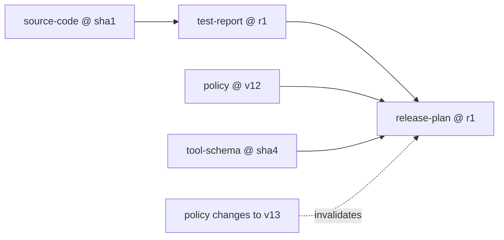
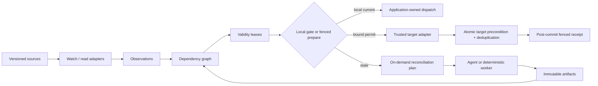

# TruthLease

**Stop AI agents from acting on an old decision after the facts behind it have
changed, and prove when a cooperating target accepted the exact authorized
effect.**

## In plain English

- **Problem:** an agent can build a plan from a policy, schema, approval, file, or
  database record and execute it later, even though one of those inputs changed.
- **Artifact:** a saved output that may be reused later, such as a plan, report,
  or decision.
- **Lease:** a short-lived, one-use ticket for one exact artifact and one exact
  effect. It says whether that use still matches the dependencies known locally.
- **What TruthLease does:** it records exactly which versions an artifact depends
  on. If one changes, TruthLease marks the affected artifacts stale, rejects their
  old leases, and calculates the reconciliation plan on demand. It does not emit
  or run a replanning request.
- **What target fencing adds:** for a cooperating target, TruthLease binds the
  dependency closure, effect, target precondition, and one stable retry identity.
  The target either commits under that exact precondition or refuses. Only a
  verified post-commit result creates a `fenced` receipt.
- **Why it matters:** durable execution can resume an interrupted workflow, but
  resuming reliably is different from checking that the saved decision is still
  valid.
- **Concrete example:** a release plan uses policy `v12` and test report `r7`.
  Policy `v13` arrives while the workflow is paused. TruthLease blocks the old
  plan, preserves test report `r7`, and identifies only the work that now needs
  reconciliation.
- **Target-race example:** the plan is locally valid, but the deployment record
  changes from ETag `"41"` to `"42"` just before execution. The strict HTTP
  profile sends `If-Match: "41"`; the target returns `412` and performs no
  effect. That is a successful safety outcome, not a blind-retry signal.

TruthLease is for teams building long-running agents, approval workflows, and
automation that may act minutes or days after an artifact was produced. It gives
developers a deterministic safety boundary and gives operators an explicit answer
about what is reusable, stale, or still uncertain.

| Feature | Practical benefit |
| --- | --- |
| Version-bound observations | Plans name the exact external facts they used. |
| Immutable artifact revisions | Old and new decisions cannot be silently mixed. |
| Bounded transitive invalidation | Unaffected work remains reusable in normal operation; an overflow fails closed globally. |
| Short-lived, single-use leases | A stale or substituted effect is rejected at the local gate. |
| Bound target preconditions and stable attempt IDs | A cooperating endpoint can reject stale state and deduplicate an ambiguous retry. |
| Post-commit fenced receipts | Operators can distinguish a local permit from a target-confirmed effect. |
| Explicit assurance and completeness | Operators can see what the runtime actually knows instead of trusting a vague safety claim. |
| Lifecycle events and SQLite integrity checks | Accepted lifecycle changes are inspectable and the local store fails closed. Denials are returned decisions, not guaranteed journal entries. |

> **TruthLease leases evidence, not truth.** It guarantees coherence only with
> respect to dependencies committed to its store and the exact scope enforced by
> a trusted target adapter. A receipt is a historical fact, not proof that the
> world is still current. Partial target coverage never becomes globally
> `fenced`.

## Quick start

TruthLease requires Python 3.11 or newer and has no third-party runtime
dependencies.

```bash
git clone https://github.com/aantenore/truthlease.git
cd truthlease
uv sync --extra dev
uv run truthlease demo --reset
```

The demo constructs this graph:



It then proves that:

- `release-plan@1` becomes stale;
- its outstanding lease becomes invalid;
- `test-report@1` remains fresh and reusable;
- an identical change event is idempotent;
- a new plan revision can acquire and consume a new lease.

## Python API

```python
from datetime import timedelta

from truthlease import (
    ArtifactDependency,
    ArtifactRef,
    AssuranceLevel,
    DependencyCompleteness,
    SQLiteStore,
    TruthLease,
)

runtime = TruthLease(SQLiteStore("truthlease.db"))

policy = runtime.observe(
    key="policy/release",
    version="v12",
    value={"two_person_review": True},
)
current_policy = runtime.get_observation("policy/release")

plan = runtime.publish_artifact(
    artifact_id="release-plan",
    kind="plan",
    payload={"steps": ["build", "verify", "promote"]},
    dependencies=[ArtifactDependency.observation(current_policy)],
    completeness=DependencyCompleteness.OBSERVED,
)

effect = {"release": "2026.07", "environment": "production"}
lease = runtime.acquire_lease(
    artifact=ArtifactRef("release-plan", plan.ref.revision),
    effect=effect,
    target="deployment/current",
    operation="promote",
    required_assurance=AssuranceLevel.OBSERVED,
    ttl=timedelta(seconds=30),
)

decision = runtime.gate_effect(lease_id=lease.lease_id, effect=effect)
assert decision.allowed
```

This local gate is still the smallest integration. It performs no network I/O
and intentionally cannot issue `fenced` assurance. The target-fencing path uses
three explicit boundaries:

```text
prepare and consume the lease in SQLite
    -> call one trusted target adapter outside SQLite
        -> record the bound result and derive a post-commit receipt
```

The bundled strict HTTP profile is deliberately not a generic status-code
wrapper. It requires a strong ETag, stable idempotency identity, canonical
request binding, no redirects, and a cooperating response that echoes the
attempt and receipt evidence. A timeout after dispatch remains
`indeterminate`; recovery must reuse the same attempt identity.

### HTTP integration sketch

This sketch shows the target contract, but is not a standalone quick start:
`example.test` is a placeholder and must be replaced by a cooperating endpoint
that implements the documented atomic precondition and deduplication protocol.

```python
from datetime import UTC, datetime

from truthlease import (
    AssuranceEvidence,
    AssuranceLevel,
    ReplayAssurance,
    StrictHttpAdapter,
    TargetPrecondition,
    execute_fenced,
)
from truthlease.canonical import digest_json

adapter_id = "release-api-v1"
evidence_authority = "policy-reader-v1"
endpoint = "https://deploy.example.test/releases/current"
runtime = TruthLease(
    SQLiteStore("truthlease.db"),
    trusted_evidence_authorities={evidence_authority},
    trusted_target_adapters={adapter_id},
)
precondition = TargetPrecondition(
    adapter_id=adapter_id,
    mechanism="http-if-match",
    expected_token='"41"',
    protected_observations=("policy/release",),
    replay_assurance=ReplayAssurance.DEDUPLICATED,
)
lease = runtime.acquire_lease(
    artifact=plan.ref,
    effect=effect,
    target=endpoint,
    operation="promote",
    required_assurance=AssuranceLevel.FENCED,
    ttl=timedelta(seconds=30),
    target_precondition=precondition,
)
evidence = AssuranceEvidence(
    level=AssuranceLevel.REVALIDATED,
    authority=evidence_authority,
    evidence_digest=digest_json(
        {"policy": "v12", "authoritative_read": True},
        domain="example:revalidation",
    ),
    observed_at=datetime.now(UTC),
    lease_id=lease.lease_id,
    closure_digest=lease.closure_digest,
    effect_digest=lease.effect_digest,
    target=lease.target,
    operation=lease.operation,
)
adapter = StrictHttpAdapter(adapter_id=adapter_id, allowed_targets={endpoint})
receipt = execute_fenced(
    runtime,
    adapter,
    lease_id=lease.lease_id,
    effect=effect,
    target_precondition=precondition,
    evidence=evidence,
)
assert receipt is not None and receipt.assurance is AssuranceLevel.FENCED
```

The evidence object must come from a real authenticated authoritative read; the
literal payload above only keeps the example compact. The endpoint must
implement the documented response-binding and deduplication contract; pointing
the adapter at an ordinary REST endpoint is not sufficient.

`observe()` returns the invalidation result rather than the observation itself;
the authoritative projection can be read with `get_observation()`.
Updating an existing key requires that projection's local `generation`, which
prevents a slow authoritative read from overwriting a newer commit:

```python
current = runtime.get_observation("policy/release")
runtime.observe(
    key=current.key,
    version="v13",
    value={"two_person_review": True, "signed_artifact": True},
    expected_generation=current.generation,
)
```

`validate_lease()` is non-consuming: it checks currentness against the latest
locally committed state. It can still deny the lease when the requested assurance
needs fresh revalidation evidence or target-side fencing that a local read cannot
provide.

## Assurance is not binary

| Level | Meaning |
| --- | --- |
| `declared` | The caller listed the dependencies; TruthLease did not observe the reads. |
| `observed` | Dependencies captured through the runtime still match its latest committed observations. |
| `revalidated` | A configured, trusted adapter reports a fresh authoritative re-read bound to this exact lease and proposed effect. |
| `fenced` | A trusted target adapter reports a bound commit that atomically enforced the required precondition, deduplicated the attempt, and covered the full observation closure. |

The local gate accepts `revalidated` evidence only from an application-configured
authority allowlist, inside the configured freshness window, and only when the
evidence binds the lease ID, dependency-closure digest, effect digest, target, and
operation. It does not execute the remote effect, so `gate_effect()` deliberately
refuses to issue `fenced` assurance. The additive target path preserves those
lower-level checks, consumes the lease before dispatch, and promotes only a
verified full-coverage commit result. Adapter statements are not
self-authenticating; applications must allowlist, configure, and secure them.

Artifacts also carry `dependency_completeness`:

- `unknown`: usable for inspection, never eligible for an effect lease;
- `declared`: eligible for declared assurance;
- `observed`: reads were captured through an integration boundary.

Completeness is inherited through required artifact dependencies: an `observed`
artifact built from a merely `declared` artifact remains effectively `declared`.

If configured graph bounds are exceeded, TruthLease enters a sticky global
fail-closed state instead of returning a misleading partial impact set. The
alpha recovery path is inspection followed by a fresh-store rebuild; old leases
are never revived by a blind reset.

## Architecture



The core is deterministic. An LLM may implement a replanning adapter, but no LLM
decides whether a version token matches, a lease expired, or an artifact is in
the invalidation closure.

Read the
[architecture](https://github.com/aantenore/truthlease/blob/main/docs/architecture.md),
[target-fencing contract](https://github.com/aantenore/truthlease/blob/main/docs/spec/coherence-v2.md),
[base coherence contract](https://github.com/aantenore/truthlease/blob/main/docs/spec/coherence-v1.md),
[threat model](https://github.com/aantenore/truthlease/blob/main/docs/threat-model.md), and
[competitive landscape](https://github.com/aantenore/truthlease/blob/main/docs/competitive-landscape.md).

## Portfolio boundaries

These public projects are complementary rather than one growing framework:

| Project | Narrow responsibility |
| --- | --- |
| **TruthLease** | Decides whether a saved plan, report, or decision still matches its known dependencies before reuse, and calculates its reconciliation scope. |
| [AgenticStrata](https://github.com/aantenore/AgenticStrata) | Defines the wider enterprise architecture, contracts, evidence receipts, replay, and conformance model around agent actions. |
| [PauseMesh](https://github.com/aantenore/pausemesh) | Pauses a long-running workflow for human approval and resumes it exactly once across disconnects or restarts. |
| [StageFabric](https://github.com/aantenore/stagefabric) | Chooses where an AI step may run across browser, local, edge, or cloud runtimes under data-placement constraints. |

## What TruthLease does not build

- a workflow engine, scheduler, or multi-agent orchestrator;
- a vector database, memory framework, or semantic cache;
- a CDC platform or message bus;
- automatic discovery of every hidden dependency in a prompt or model weight;
- distributed transactions, universal rollback, or exactly-once external effects;
- an authentication, authorization, or policy engine.

Use Restate, Temporal, or LangGraph for durable execution; Drasi or Debezium for
high-volume change capture; a policy engine for authorization; and target-side
idempotency plus fencing for durable effects. TruthLease connects their version
evidence to the artifacts that an agent may later use.

## Why a separate project

Existing systems solve adjacent pieces:

- [Restate durable agents](https://docs.restate.dev/ai/patterns/durable-agents)
  record completed steps and resume them without recomputation.
- [Drasi](https://drasi.io/concepts/) detects meaningful changes across data
  sources but does not know which agent decision depended on them.
- [Bazel Skyframe](https://bazel.build/reference/skyframe) and
  [Salsa](https://salsa-rs.github.io/salsa/reference/algorithm.html) track
  deterministic computation dependencies.
- [W3C PROV-O](https://www.w3.org/TR/prov-o/) describes provenance but does not
  enforce freshness at runtime.
- Recent work on [stale agent memories](https://arxiv.org/abs/2605.06527) and
  [commit-time authorization](https://arxiv.org/abs/2607.10487) demonstrates
  that retrieving or resuming state is not enough when its authority changes.

TruthLease's narrow contribution is the combination of versioned artifact
identity, dependency version vectors, bounded minimal invalidation, validity
leases, and a framework-neutral binding from the exact dependency closure and
effect to target-side conditional commit evidence. Optimistic concurrency and
idempotency are established primitives; the differentiated part is their
verifiable connection to agent artifact lineage and honest coverage reporting.
Digest identity is implementation-local until a cross-language canonicalization
profile and golden vectors are published.

## Development

```bash
uv sync --extra dev
uv run ruff format --check .
uv run ruff check .
uv run mypy
uv run pytest --cov=truthlease --cov-report=term-missing
uv run python benchmarks/benchmark_fence_correctness.py
uv build
```

This is an executable alpha. See
[CONTRIBUTING.md](https://github.com/aantenore/truthlease/blob/main/CONTRIBUTING.md)
and [SECURITY.md](https://github.com/aantenore/truthlease/blob/main/SECURITY.md).
Apache-2.0 licensed.
