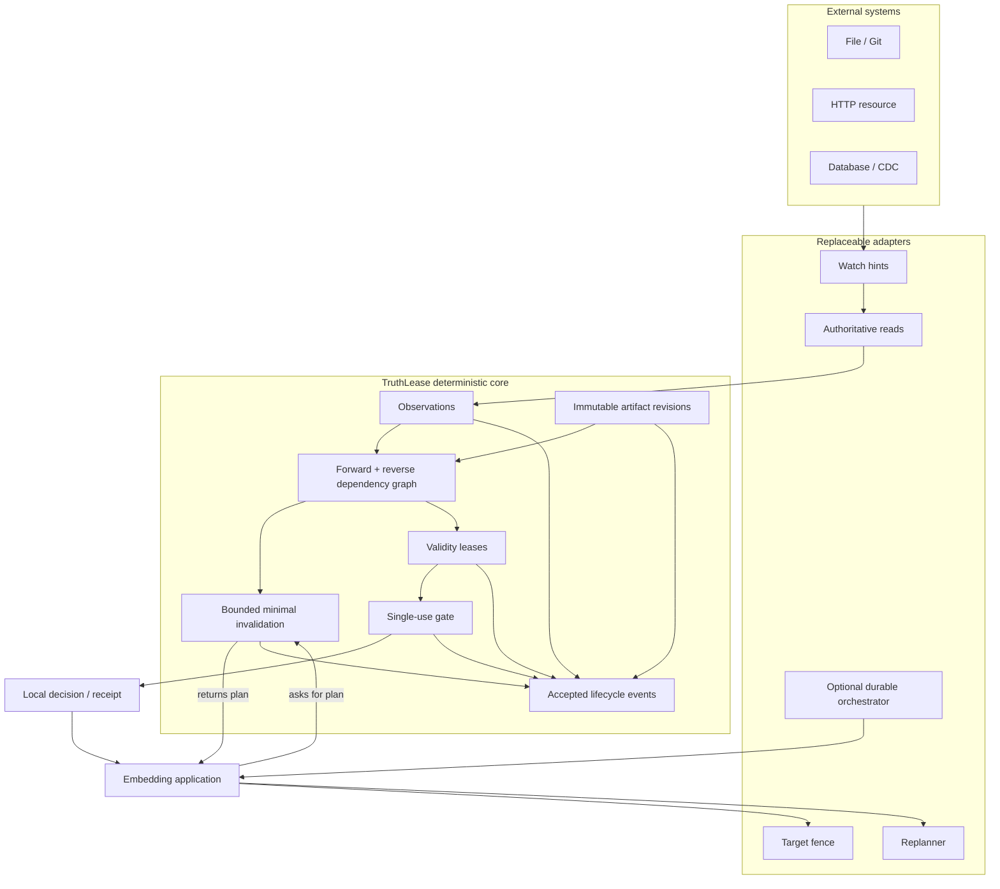
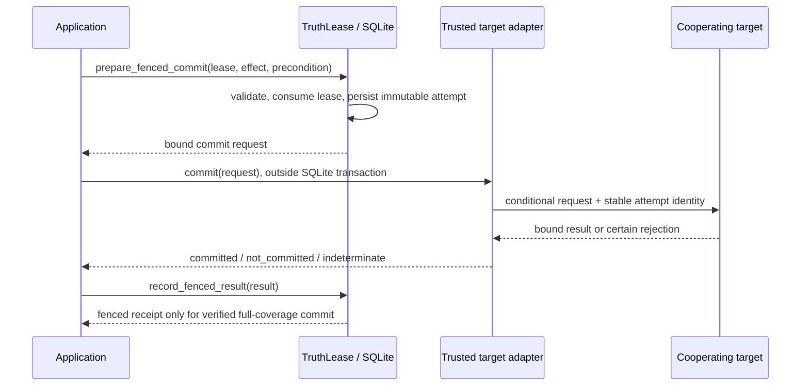
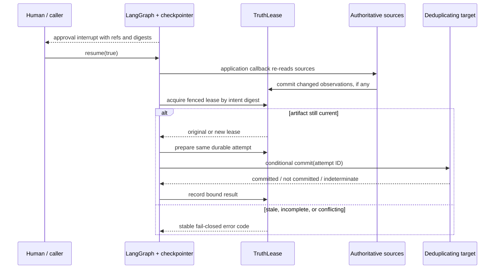

# Architecture

TruthLease is a deterministic coherence control plane for artifacts produced by
agents or ordinary software. It tracks explicit dependencies and answers one
narrow question at use time:

> Does this exact artifact revision still match every required dependency known
> to this runtime?

It does not interpret natural language, schedule workflows, retrieve memory, or
coordinate transactions across targets. When a dependency changes, it calculates
a reconciliation plan only when the application asks for one; it does not enqueue
or execute that work. Its optional target path invokes one explicit adapter after
the local transaction has closed.

## Guarantee boundary

The local guarantee is:

> No effect becomes dispatchable from an artifact invalidated by information
> committed to the same TruthLease database before the gate transaction
> completes.

This is linearizable relative to the local SQLite store. It is not a distributed
transaction with a remote source or target. The `fenced` level additionally
requires one trusted adapter to report a target-side conditional commit bound to
the exact effect and full protected observation closure. That receipt is a
historical commit fact, not a claim of ongoing freshness.

## Components



The deterministic core, SQLite adapter, strict HTTP conformance profile, and an
optional LangGraph stale-safe resume composition are implemented in
`0.3.0-alpha.1`. Provider and framework integrations remain explicit extension
boundaries rather than hidden core dependencies.

## Domain objects

### Observation

An observation names one external resource state:

```text
(key, opaque version token, local generation, content digest,
 observed_at, valid_until, status)
```

Version tokens are compared for exact equality. TruthLease never orders an
opaque ETag lexicographically. A webhook should be treated as a change hint;
promotion to `current` requires an authoritative read.
Every committed change advances a per-key generation. Updating an existing key
requires compare-and-swap against the generation captured before the external
read, so a delayed response cannot overwrite a newer local observation. An
identical refresh with no projection change keeps the same generation.

### Artifact revision

An artifact revision contains:

```text
(artifact id, revision, kind, payload digest, dependencies,
 dependency completeness, reconciliation policy, status)
```

Payload digest and dependencies are immutable. Replanning creates a new
revision. Status is a derived projection and may move from `fresh` to `stale`,
`unknown`, or `disputed`; an old revision is never silently refreshed.

The read API returns an effective status evaluated at read time. In particular,
an artifact whose required observation has crossed `valid_until` is no longer
reported as effectively fresh merely because its stored invalidation projection
has not changed yet. Lease acquisition and validation use the same time-aware
currentness rule.

### Dependency

A required dependency participates in freshness and invalidation. An advisory
dependency is recorded but does not block a lease.

```text
observation edge = (key, expected version, expected generation, expected digest)
artifact edge    = (artifact id, expected revision, expected digest)
```

### Validity lease

A lease binds:

- one immutable artifact revision and payload digest;
- the sorted transitive observation snapshot;
- one target, operation, and canonical effect digest;
- dependency completeness and required assurance;
- issue and expiry time;
- an optional application-controlled boot epoch.

Dependency completeness is monotone across required artifact edges: the runtime
stores and leases the minimum completeness in the transitive closure. A derived
artifact therefore cannot relabel declared upstream evidence as observed.

Leases are single-use. `consumed`, `expired`, `invalidated`, and `revoked` are
terminal states.

An optional digest-only lease request identity sits beside the lease. It binds a
caller-provided idempotency digest to the complete lease intent: artifact,
effect, target, operation, assurance, TTL, boot epoch, and target-precondition
descriptor. An identical retry can therefore recover the original lease after a
workflow-node restart, including when that lease is already consumed. Reusing
the key for a different intent fails closed. The binding never stores the raw
effect, opaque target token, or raw workflow label.

An optional target-precondition binding is stored separately so the closed v1
lease read model remains unchanged. It binds the adapter and mechanism, a digest
of the opaque expected token, replay assurance, and a digest of the exact
observation snapshots claimed to be protected. Raw target tokens are not stored.

`validate_lease()` is a non-consuming, local-currentness check. It may deny an
otherwise current lease when the requested assurance is above what the local
store can establish. `gate_effect()` additionally binds and consumes the exact
effect when all requirements are satisfied; the embedding application remains
responsible for dispatch.

Revalidation evidence must be fresh, come from a configured authority allowlist,
and bind the lease ID, closure digest, effect digest, target, and operation. The
levels are cumulative: a `fenced` result retains the local and any required
revalidation evidence and adds a target result bound to the same lease, closure,
effect, target, operation, precondition, and protected scope.

## Target-fencing protocol



Preparation is idempotent only for identical inputs. Once dispatch may have
occurred, recovery reuses the same attempt and fingerprint. An ambiguous result
cannot be promoted and cannot be replaced with a new attempt. A conflicting
result marks the attempt disputed.

The HTTP profile is intentionally strict: strong ETag only, canonical JSON,
stable idempotency key, fixed endpoint, no redirects, bounded response, and
explicit response bindings. For a previously unseen attempt, `412` means the
protected effect was not applied. A conforming target resolves a known attempt
and verifies its original request fingerprint before evaluating the current
ETag, so retry after a lost response cannot turn an earlier commit into `412`.
A `2xx` without the required evidence remains indeterminate.

## Optional durable-resume composition

TruthLease does not become a workflow engine. The LangGraph integration is an
adapter above the same public core and target-fencing protocol:



LangGraph persists workflow position. TruthLease separately evaluates current
artifact eligibility and owns the durable lease/attempt identities. The graph
stores only state version, references, digests, IDs, phase, approval, and stable
decision codes. Raw effects and preconditions are reconstructed through host
callbacks and verified twice: after authoritative revalidation and immediately
before execution.

Ambiguous recovery deliberately skips new authorization and resolves the
already prepared target attempt. The original immutable references must remain
available; if they cannot be reconstructed exactly, recovery stops. See
[the integration guide](langgraph-integration.md) and
[ADR 0003](adr/0003-langgraph-stale-safe-resume.md).

## Freshness predicate

For artifact `a`, store state `S`, and time `t`:

```text
fresh(a, S, t) :=
  status(a) = fresh
  and completeness(a) != unknown
  and for every required dependency d of a:
      current(d, S, t) exactly matches expected(d)
      and, if d is an artifact, fresh(d, S, t)
```

Dependencies are captured explicitly. TruthLease cannot detect a file, prompt,
tool result, or model weight that the producer failed to declare.

## Minimal invalidation

When observation `r` changes:

```text
I0 = required direct dependants of r whose expected token no longer matches
I(n+1) = I(n) union required artifact dependants of every node in I(n)
Impact(r) = least fixed point of I
```

The reverse index lets TruthLease visit only the closure. The observation write,
artifact status changes, and active lease invalidation share one transaction.
Depth and node limits bound adversarial fan-out.

Minimality is guaranteed only while that traversal completes inside the configured
bounds. If it overflows, the runtime switches to a global fail-closed fallback in
the same local transaction: every artifact becomes `unknown` and every active
lease is invalidated. This intentionally sacrifices reuse instead of returning an
incomplete impact set as though it were minimal.
The alpha fault is sticky: per-ID result collections are unavailable and
`truthlease doctor` reports the fault. Recovery requires inspecting the graph,
raising or redesigning the bounds, and rebuilding a fresh store; there is no
unsafe "clear fault" switch that could revive old leases.

## Event and audit boundary

TruthLease stores append-only, deduplicated events for accepted lifecycle changes,
including observation commits, artifact publication, lease issuance, and
successful lease consumption. A denial is always returned as a structured gate
decision, but denial attempts are not guaranteed to be written to the event log.
Applications that require a complete access-attempt audit must persist those
decisions in their own audit sink.

The JSON Schema is an alpha read-model subset for selected observation, artifact,
lease, and gate-decision representations. It is not a schema for the entire
behavioral contract, event history, evidence policy, or transaction protocol.

The v1 canonical JSON and domain-separated digest profile is defined by the Python
implementation. It provides stable identity inside this implementation/version,
not a cross-language digest guarantee. Cross-language interoperability requires a
separately versioned canonicalization profile with shared golden vectors.

## Concurrency and durability

The SQLite adapter uses:

```text
journal_mode=DELETE
synchronous=FULL
foreign_keys=ON
trusted_schema=OFF
read_uncommitted=OFF
BEGIN IMMEDIATE for writes
bounded busy_timeout
```

A single writer is an intentional MVP constraint. Two concurrent gate or prepare
attempts serialize; only one can consume the lease. The prepared request is
returned after commit, so no network request is made while a database transaction
is open. Finalization is a separate write transaction.

Rollback journaling is the conservative default. SQLite documents a historical
[WAL-reset concurrency issue](https://www.sqlite.org/wal.html#the_wal_reset_bug),
so a future WAL mode must be opt-in and version-gated rather than silently
enabled.

## Dependency direction

```text
CLI / optional orchestrator integration / target adapter
        ↓
application service (TruthLease)
        ↓
immutable models + canonical digests
        ↓
storage port implementation
```

The deterministic core imports no model SDK, workflow engine, CDC product, or
policy engine. Future adapters must return typed observations or evidence and
must not mutate artifact status directly.

## Integration boundaries

- **Restate / Temporal / LangGraph:** execute or resume reconciliation work.
- **MCP resource subscriptions:** provide change hints, followed by re-read.
- **Drasi / Debezium:** deliver high-volume source changes.
- **[AgenticStrata](https://github.com/aantenore/AgenticStrata):** bind a
  TruthLease gate receipt into wider execution evidence and conformance.
- **[PauseMesh](https://github.com/aantenore/pausemesh):** hold and resume a
  human-approval workflow; TruthLease independently checks whether the saved
  artifact is still usable.
- **[StageFabric](https://github.com/aantenore/stagefabric):** choose an allowed
  execution placement; TruthLease does not select a runtime.
- **HTTP conditional requests:** enforce a strong ETag with `If-Match` at the
  target.

These integrations are complementary; none is a hidden dependency of the core.
