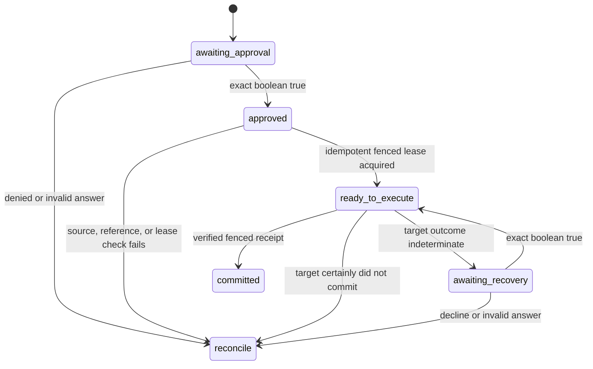

# LangGraph stale-safe resume

## What it solves

A durable workflow can remember exactly where it paused and still resume an old
decision after the facts behind that decision changed. This integration makes
the resume boundary explicit:

1. LangGraph persists the workflow position and waits for approval.
2. On resume, the host re-reads authoritative sources into TruthLease.
3. TruthLease issues or recovers one intent-bound fenced lease.
4. The raw effect and target precondition are resolved again and compared with
   their checkpointed digests.
5. A cooperating target commits once, rejects the stale precondition, or leaves
   the attempt explicitly indeterminate.
6. Ambiguous recovery reuses the same lease and attempt; it never creates a new
   effect identity.

LangGraph documents that interrupted nodes restart from the beginning and that
side effects before an interrupt must be idempotent. It also describes
checkpoints as persisted workflow state, not as proof that external authority is
still current. TruthLease supplies that separate commit-time coherence boundary.

- [LangGraph interrupts](https://docs.langchain.com/oss/python/langgraph/interrupts)
- [LangGraph persistence](https://docs.langchain.com/oss/python/langgraph/persistence)
- [LangGraph checkpointer integrations](https://docs.langchain.com/oss/python/integrations/checkpointers/index)
- [Commit-time authorization paper](https://arxiv.org/abs/2607.10487)

## Install

The core keeps zero mandatory third-party runtime dependencies:

```bash
pip install truthlease
```

Install the optional integration for LangGraph `1.2.x` and the SQLite
checkpointer `3.1.x`:

```bash
pip install "truthlease[langgraph]"
```

SQLite is appropriate for local and small synchronous workflows. The graph
accepts the LangGraph `BaseCheckpointSaver` interface, so a host can supply a
different durable saver. Backend setup, concurrency, encryption, retention, and
backup remain host responsibilities.

## Replaceable boundaries

`build_stale_safe_graph()` accepts six application-owned boundaries:

| Boundary | Contract |
| --- | --- |
| `checkpointer` | Persist and restore LangGraph checkpoints. |
| `revalidate(runtime, artifact_ref)` | Re-read authoritative sources and commit any changed observations before returning. |
| `resolve_effect(effect_ref)` | Return the exact raw effect represented by the immutable reference. |
| `resolve_precondition(precondition_ref)` | Return the exact original target precondition, including the opaque token. |
| `evidence_provider(runtime, lease)` | Produce fresh, allowlisted, lease-bound `AssuranceEvidence` for the first target attempt. |
| `target_adapter` | Enforce the target precondition and deduplicate by the stable attempt identity. |

No callback is hardcoded to HTTP, a model provider, a policy system, or one
checkpoint backend.

## Checkpoint contract

The graph persists only these classes of value:

- schema and phase;
- digest-only idempotency key;
- artifact ID and revision;
- effect and precondition references plus their canonical digests;
- target and operation;
- lease, attempt, and receipt IDs;
- approval booleans, a digest of the exact recovery basis, and stable
  decision/reconciliation codes.

It does not place these values in graph state:

- prompt or conversation text;
- raw effect body;
- raw target precondition token;
- revalidation evidence payload;
- callback exception message.

References are not automatically secret. Use opaque, immutable, versioned
references and do not put credentials or payloads into them. The supplied
`workflow_idempotency_key()` is an unkeyed canonical digest that removes a raw
workflow label from the two stores; it is not encryption and does not hide a
low-entropy value from guessing. Use an application-owned keyed digest when
that distinction matters.

Use the same digest as the LangGraph `thread_id` to avoid putting the raw
workflow identifier into checkpointer metadata:

```python
workflow_key = workflow_idempotency_key({"workflow": "release-2026.07"})
config = {"configurable": {"thread_id": workflow_key}}
```

The following node names and state fields are a persistence contract for paused
workflows:

```text
approval_v1
authorize_v1
execute_fenced_v1
recover_indeterminate_v1
```

Do not rename them or change their meaning while checkpoints created with state
version `1` may still resume. A future incompatible graph must add an explicit
state migration or use new versioned node names.

## Lifecycle



### Initial approval

`make_resume_state()` hashes the raw effect and precondition but returns only
their references and digests. The first invocation reaches a LangGraph
`interrupt()`. Approval accepts the exact JSON boolean `true`; strings such as
`"yes"` fail closed.

### Authorize after resume

The authorization node first runs `revalidate`. It then resolves the effect and
precondition and compares both with their checkpointed digests. Only then does
it call `acquire_lease(..., idempotency_key=...)` at `fenced` assurance.

SQLite schema v3 binds that idempotency key to a digest of:

- artifact ID and revision;
- effect digest;
- target and operation;
- requested assurance;
- exact lease TTL in microseconds;
- runtime boot epoch;
- target-precondition descriptor digest.

An identical retry returns the original lease even when it is already consumed
or invalidated, which is necessary to recover its existing target attempt. A
different intent with the same key raises `CONFLICT` before target dispatch.

### Execute

The execution node resolves and verifies the effect and precondition again. For
a new attempt it asks the host for fresh evidence, durably prepares and consumes
the lease, then calls the target outside the TruthLease SQLite transaction.

For an existing attempt, it does not mint new evidence or a new attempt. A
terminal committed result returns the existing fenced receipt without calling
the target again. A certain target rejection ends in reconciliation.

### Recover an ambiguous target call

If a response is lost after the target may have committed, TruthLease records
the attempt as `indeterminate` and the graph pauses again. An approved recovery
resolves the original immutable references and dispatches the same prepared
attempt. A conforming target must look up a known attempt and verify its original
request fingerprint before considering the current precondition.

Recovery approval is bound to a canonical digest of the attempt ID, durable
status, and recorded result digest. If another worker changes that durable
outcome while approval is paused, the old approval cannot authorize a dispatch;
the graph re-evaluates the new basis first. A terminal committed, rejected, or
disputed outcome always overrides the stale recovery response, including a
decline or malformed response, and is reported without resolving the raw effect
again. Approval does remain durable through a process crash while resolving the
same unchanged ambiguous basis. That may repeat a transport call, but never
creates a new logical attempt; target deduplication is therefore mandatory.

This recovery step determines what happened to the earlier attempt; it is not a
new authorization decision. If a still-ambiguous attempt's original effect or
precondition can no longer be resolved exactly, the graph stops rather than
guessing.

## Outcomes

| `phase` | Example `decision_code` | Meaning |
| --- | --- | --- |
| `committed` | `FENCED_COMMIT_RECORDED` | TruthLease verified a full-coverage, deduplicated target commit and stored its receipt. |
| `reconcile` | `ARTIFACT_NOT_FRESH` | An authoritative change invalidated the saved artifact before effect dispatch. |
| `reconcile` | `AUTHORITATIVE_REVALIDATION_FAILED` | The authoritative source could not be read; exception details were not checkpointed. |
| `reconcile` | `EFFECT_REFERENCE_UNAVAILABLE` | The saved effect reference could not be resolved. |
| `reconcile` | `EFFECT_REFERENCE_CHANGED` | The effect resolver no longer returned the checkpointed effect. |
| `reconcile` | `PRECONDITION_REFERENCE_UNAVAILABLE` | The saved precondition reference could not be resolved. |
| `reconcile` | `PRECONDITION_REFERENCE_CHANGED` | The original target precondition could not be reconstructed exactly. |
| `reconcile` | `EVIDENCE_PROVIDER_FAILED` | Fresh assurance evidence could not be constructed, before any target dispatch. |
| `reconcile` | `TARGET_PRECONDITION_REJECTED` | The cooperating target certainly did not apply the effect. |
| `awaiting_recovery` | `TARGET_OUTCOME_INDETERMINATE` | The attempt may have committed; only same-attempt recovery is allowed. |
| `reconcile` | `CONFLICT` | The workflow key was reused for a different lease intent. |

These codes are checkpoint-safe summaries. Persist detailed operational errors
in an application-owned, access-controlled telemetry sink rather than graph
state.

## Tested failure matrix

The executable suite uses the real LangGraph `SqliteSaver` and closes/reopens
its database to simulate process restart. It verifies:

- clean pause, restart, approval, and one fenced commit;
- policy change during the pause with zero target dispatches;
- target ETag change with a certain non-commit;
- duplicate workflow dispatch with one target effect and one evidence read;
- response loss after target commit, same-attempt recovery, and one target
  effect;
- process death after a prepared or indeterminate attempt, with zero redispatch
  before a recovery decision;
- local result-persistence failure after a target commit, with same-attempt
  recovery instead of a false terminal failure;
- an attempt result changing while recovery approval is paused, with the old
  recovery basis refused;
- unknown dependency completeness with zero target dispatches;
- missing, invalid, and changed effect or precondition references with zero
  target dispatches;
- authoritative-read and evidence-provider failures reduced to redacted,
  stage-specific decision codes;
- idempotency-key reuse for different intent failing closed;
- exact-boolean approval and recovery decisions;
- absence of raw effect and raw target token in both checkpoint and TruthLease
  database bytes.

The suite does not prove the behavior of an arbitrary target adapter, source
reader, checkpointer deployment, or compromised host. Those remain explicit
trust boundaries.

## Non-goals

This adapter is not:

- a general LangGraph agent template;
- an IAM or policy engine;
- a compensation or multi-target transaction coordinator;
- a guarantee of exactly-once external effects without target deduplication;
- a replacement for application telemetry, checkpoint encryption, or backups;
- an automatic dependency-discovery system.

The architectural decision and migration consequences are recorded in
[ADR 0003](adr/0003-langgraph-stale-safe-resume.md).
