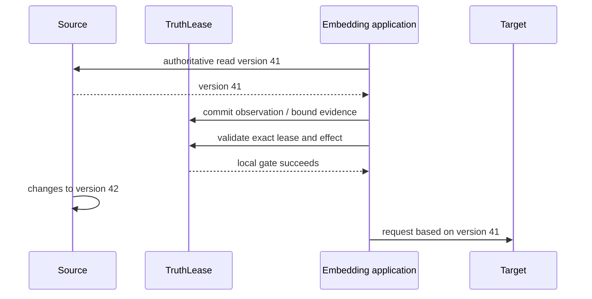

# Threat model

## Scope and trust assumptions

The `0.3` alpha assumes:

- the host, operating system, Python process, and SQLite file owner are trusted;
- one application or physically separate database owns each trust domain;
- configured Python adapters are trusted application code and their identities
  are allowlisted by the embedding application;
- external sources are authoritative only when registered by the embedding
  application;
- a target that claims conditional commit and deduplication implements both
  atomically for the scope declared by its adapter;
- durable-orchestrator checkpoints, effect/precondition reference stores, and
  the callbacks that resolve them are inside the trusted host boundary.

TruthLease does not claim secure multi-tenancy inside one SQLite database.

## Assets

- observation version and digest integrity;
- immutable artifact payload and dependency identity;
- active lease secrecy and single-use state;
- gate receipt and accepted-lifecycle event history integrity;
- immutable attempt, precondition, scope, request, and target-result bindings;
- lease-request identity and immutable workflow-reference bindings;
- distinction between confirmed, rejected, and indeterminate remote outcomes;
- availability of the invalidation and gate path.

## Threats and controls

| Threat | Control | Residual risk |
| --- | --- | --- |
| Forged fresh state | Artifact status is projection-derived; clients never set it. | A compromised host can alter the database. |
| Duplicate, conflicting, or delayed source event | Unique source/event identity plus per-key generation compare-and-swap; identical duplicates are no-ops and changed payloads fail. | Adapters must capture generation before the authoritative read and retry conflicts with a new read. |
| Hidden dependency | Completeness is visible and `unknown` cannot lease. | Declared or observed capture may still omit an out-of-band input. |
| Dependency laundering | Artifact and lease completeness are capped by the minimum across the required transitive closure. | Model weights and implicit reasoning causes are outside scope. |
| Stolen or substituted lease | High-entropy ID, exact artifact/effect/target/operation binding, expiry, single use. | The embedding application must protect the ID. |
| Source changes after local gate | Explicit assurance label and residual-race text. | Only target-side fencing closes this race. |
| Target changes after local prepare | A trusted adapter must atomically enforce the bound precondition; the HTTP profile uses strong `If-Match`. | The adapter assertion cannot prove a dishonest or incorrectly implemented target. |
| Duplicate effect after a lost response | The attempt ID is stable and the target contract declares deduplicated replay; recovery reuses the same request fingerprint. | If target retention expires before resolution, the outcome remains indeterminate and automatic retry stops. |
| Duplicate workflow-node execution | A digest-only idempotency key atomically binds the full lease intent and recovers the original lease, including its consumed attempt. Ambiguous recovery approval is bound to the attempt status and result digest. | Different workflow keys can intentionally create different leases; an approved resolution may repeat transport after a crash and therefore still requires target deduplication. |
| Stale durable checkpoint | Resume performs an authoritative re-read, verifies immutable effect and precondition references, and acquires a current fenced lease before first dispatch. | An undeclared dependency or dishonest authoritative source remains outside the guarantee. |
| Reference changes between authorization and execution | The execute node resolves and verifies the effect and precondition a second time before target dispatch. | A compromised resolver or host can substitute both data and control flow. |
| Raw payload leakage through checkpoint state | The supplied state contract stores references, digests, IDs, booleans, phases, and stable codes; tests scan both SQLite stores for raw effect and target-token fixtures. | References, LangGraph thread IDs, host logs, and custom callback telemetry can still leak data if the application puts secrets in them. |
| Tampered or guessed checkpoint digest | Core intent binding detects inconsistent reuse, and changed references fail closed. | Digests are not signatures or encryption; the trusted-host assumption remains, and low-entropy identifiers need a keyed digest for confidentiality. |
| Exception text persisted by integration | Callback failures are reduced to stage-specific stable codes before being returned as graph state. | Failures outside the caught node boundary or application logging can still expose exception details. |
| False global fencing from a narrow token | The scope digest names the exact protected observation snapshots; only full closure coverage can derive `fenced`. | The embedding application must describe which facts the target token actually protects. |
| Forged success response | The result must bind the attempt, request, closure, effect, precondition, scope, adapter, target, and operation. | A compromised trusted adapter or host can still fabricate evidence. |
| Conflicting result replay | Indeterminate evidence may resolve under the same attempt. A late transport ambiguity cannot erase a known terminal fact, while different terminal evidence marks the attempt disputed, invalidates its historical receipt, and fails closed. | Operators must investigate the target and adapter before recovery. |
| Redirect or endpoint substitution | The strict HTTP profile fixes one endpoint and disables redirects. | DNS, TLS, and endpoint credentials remain host responsibilities. |
| Response-body exhaustion or header injection | Bounded reads, strict media type, and input validation reject malformed evidence and reserved-header overrides. | The application still needs process-level resource limits. |
| Conflicting source content | Same version with a different digest becomes `disputed`; effects fail closed. | TruthLease cannot decide which external authority is correct. |
| Graph denial of service | Configurable depth and node limits; overflow marks all artifacts `unknown` and invalidates all active leases in one local transaction. | The global fallback preserves safety but sacrifices availability and reuse; large legitimate graphs require a different store adapter. |
| SQLite unsafe defaults | Foreign keys, full sync, trusted schema off, rollback journal, integrity doctor. | Filesystem or host failure can still corrupt storage; backups remain required. |
| Secret leakage | Core stores digests and references rather than payload bodies. | Low-entropy sensitive values need an application-owned keyed digest. |
| Malicious or replayed revalidation evidence | Evidence binds the lease, closure, effect, target, and operation; authorities are allowlisted and evidence has a freshness window. | The host must authenticate allowlisted adapters and protect its configuration. |
| Expired source presented as fresh | Effective status is evaluated at read, lease, and gate time against `valid_until`. | A dishonest source can still publish a misleading validity window. |
| Missing denial audit | Denials are structured return values but are not guaranteed lifecycle-event entries. | Applications requiring a complete attempt audit must persist denial decisions separately. |

## TOCTOU boundary

Without a target-side `If-Match: 41` or equivalent compare-and-set, TruthLease
cannot atomically bridge this gap. The fenced path instead prepares an immutable
attempt, closes the local transaction, and asks a cooperating target to enforce
the bound precondition and deduplicate that attempt in its own atomic commit.
Only the subsequently verified result can produce the historical `fenced`
receipt. `observed` and `revalidated` never claim that guarantee.

## Operational controls

- Place the database in an owner-only directory.
- Keep lease TTLs short and rotate the boot epoch when a service restart must
  invalidate outstanding authority.
- Keep the revalidation freshness window short, allowlist the minimum necessary
  authorities, and authenticate adapter calls outside the database transaction.
- Run `truthlease doctor` after abnormal shutdown and as a readiness check.
- Treat a reported coherence fault as sticky. Inspect the graph and rebuild into
  a fresh store with appropriate bounds; never edit the fault row or revive old
  leases in place.
- Use the SQLite backup API or a transactionally consistent filesystem snapshot;
  do not copy a live database blindly.
- Treat watch notifications as hints and re-read the authoritative source.
- Do not call network adapters while holding a TruthLease transaction.
- Never retry a non-idempotent external effect after an ambiguous outcome without
  authoritative verification.
- Reuse the original attempt and request fingerprint when resolving an ambiguous
  target call; never mint a fresh key merely because the caller timed out.
- Derive one stable, digest-only workflow key per logical effect and use it for
  both TruthLease idempotency and the LangGraph `thread_id`; do not place a raw
  user, prompt, credential, or business identifier in either field.
- Keep effect and precondition references immutable and resolvable for at least
  the full checkpoint and target-deduplication recovery horizon.
- Treat LangGraph state version and node names as a persistence contract. Migrate
  paused checkpoints before renaming either.
- For production checkpointers, configure access control, encryption, retention,
  concurrency, and backups independently of TruthLease.
- Keep target deduplication retention longer than the maximum retry and recovery
  horizon. When retention is unknown or expired, stop automatically.
- Treat partial scope as partial even when the target commit succeeds. Separate
  target receipts do not imply atomicity across multiple systems.
- Do not place raw effect bodies, target tokens, credentials, or response bodies
  in logs. TruthLease persists their canonical bindings and a receipt reference.

Security issues should follow [SECURITY.md](../SECURITY.md).
