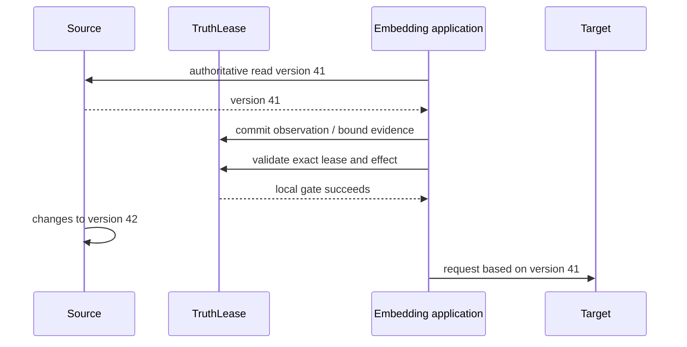

# Threat model

## Scope and trust assumptions

The `0.1` alpha assumes:

- the host, operating system, Python process, and SQLite file owner are trusted;
- one application or physically separate database owns each trust domain;
- arbitrary Python adapters are trusted application code;
- external sources are authoritative only when registered by the embedding
  application;
- strong remote safety requires target fencing or idempotency outside the core.

TruthLease does not claim secure multi-tenancy inside one SQLite database.

## Assets

- observation version and digest integrity;
- immutable artifact payload and dependency identity;
- active lease secrecy and single-use state;
- gate receipt and accepted-lifecycle event history integrity;
- availability of the invalidation and gate path.

## Threats and controls

| Threat | Control | Residual risk |
| --- | --- | --- |
| Forged fresh state | Artifact status is projection-derived; clients never set it. | A compromised host can alter the database. |
| Duplicate, conflicting, or delayed source event | Unique source/event identity plus per-key generation compare-and-swap; identical duplicates are no-ops and changed payloads fail. | Adapters must capture generation before the authoritative read and retry conflicts with a new read. |
| Hidden dependency | Completeness is visible and `unknown` cannot lease. | Declared or observed capture may still omit an out-of-band input. |
| Dependency laundering | Artifact and lease completeness are capped by the minimum across the required transitive closure. | Model weights and implicit reasoning causes are outside scope. |
| Stolen or substituted lease | High-entropy ID, exact artifact/effect/target/operation binding, expiry, single use. | The embedding application must protect the ID. |
| Source changes after local gate | Explicit assurance label and residual-race text. | Only target-side fencing closes this race. |
| Conflicting source content | Same version with a different digest becomes `disputed`; effects fail closed. | TruthLease cannot decide which external authority is correct. |
| Graph denial of service | Configurable depth and node limits; overflow marks all artifacts `unknown` and invalidates all active leases in one local transaction. | The global fallback preserves safety but sacrifices availability and reuse; large legitimate graphs require a different store adapter. |
| SQLite unsafe defaults | Foreign keys, full sync, trusted schema off, rollback journal, integrity doctor. | Filesystem or host failure can still corrupt storage; backups remain required. |
| Secret leakage | Core stores digests and references rather than payload bodies. | Low-entropy sensitive values need an application-owned keyed digest. |
| Malicious or replayed revalidation evidence | Evidence binds the lease, closure, effect, target, and operation; authorities are allowlisted and evidence has a freshness window. | The host must authenticate allowlisted adapters and protect its configuration. |
| Expired source presented as fresh | Effective status is evaluated at read, lease, and gate time against `valid_until`. | A dishonest source can still publish a misleading validity window. |
| Missing denial audit | Denials are structured return values but are not guaranteed lifecycle-event entries. | Applications requiring a complete attempt audit must persist denial decisions separately. |

## TOCTOU boundary

Without a target-side `If-Match: 41` or equivalent compare-and-set, TruthLease
cannot atomically bridge this gap. `observed` and `revalidated` therefore never
claim the guarantee of `fenced`.

## Operational controls

- Place the database in an owner-only directory.
- Keep lease TTLs short and rotate the boot epoch when a service restart must
  invalidate outstanding authority.
- Keep the revalidation freshness window short, allowlist the minimum necessary
  authorities, and authenticate adapter calls outside the database transaction.
- Run `truthlease doctor` after abnormal shutdown and as a readiness check.
- Treat a reported coherence fault as sticky. Inspect the graph and rebuild into
  a fresh store with appropriate bounds; never edit the fault row or revive old
  leases in place.
- Use the SQLite backup API or a transactionally consistent filesystem snapshot;
  do not copy a live database blindly.
- Treat watch notifications as hints and re-read the authoritative source.
- Do not call network adapters while holding a TruthLease transaction.
- Never retry a non-idempotent external effect after an ambiguous outcome without
  authoritative verification.

Security issues should follow [SECURITY.md](../SECURITY.md).
